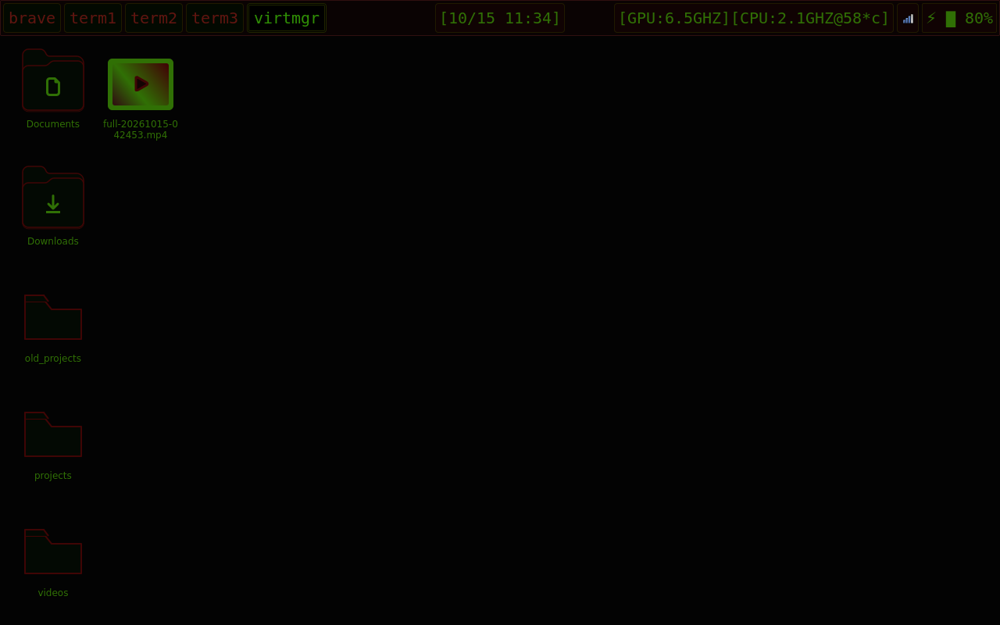
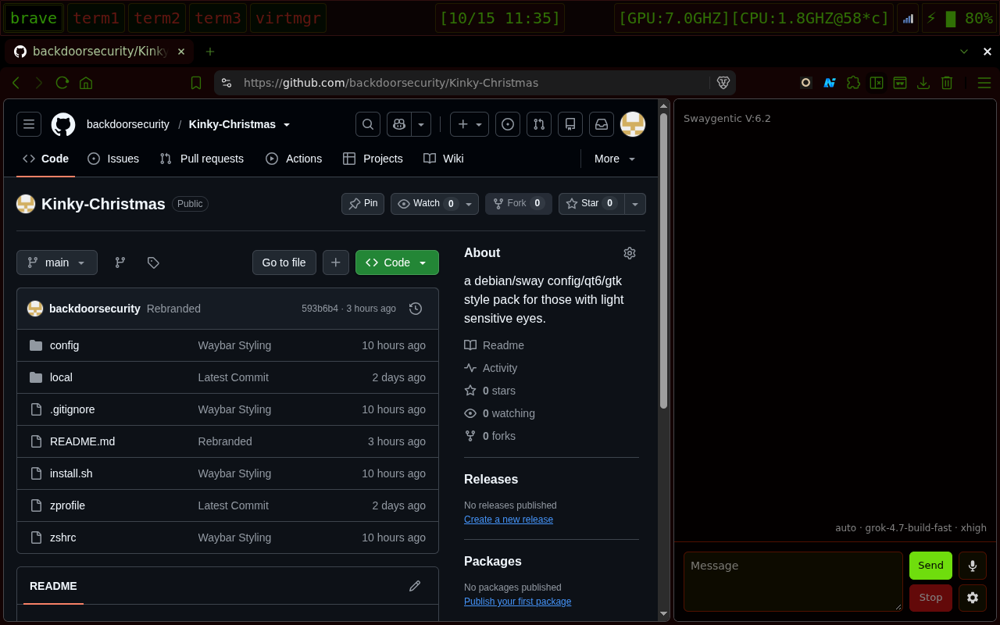

# Kinky-Chistmas
  
  
Very dark Debian/Sway theme kit and sway config for those with light-sensitive eyes.  
This is my personal repo i use for fresh installs, open for anyone to use.  
  
  
[Install]  
  
```bash
git clone https://github.com/backdoorsecurity/Kinky-Chistmas.git
cd Kinky-Chistmas
./install.sh
```
  
  
[Hotkeys]  
<h2 align="center">HOTKEY MAP:</h2>

`alt+a,s,d,f,g:   workspaces 1-5`

`alt+q:           brave-origin-nightly`

`alt+w,e,r:       foot terminal`

`alt+t:           virt-manager`

`alt+x:           kill window`

`alt+c:           copy`

`alt+v:           paste`

`print:           screenshot`

`alt+print:       screenrecord`

`these can be changed in ~/.config/sway/config and ~/.config/sway/keybindings`  
  
  
   
   
